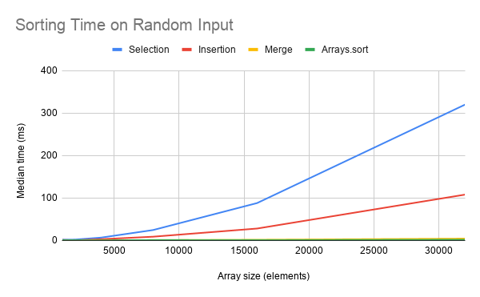

# Sorting and Efficiency Report

Oscar Zhu — ICS4U

## Question

How do array size and input order affect the comparison counts and running times of selection sort, insertion sort,
merge sort, and Java's Arrays.sort? I compared measured results with the expected growth of each algorithm.

## Method

I used a 2023 15-inch MacBook Air with an Apple M2 chip, 8 GB of RAM, macOS, and Temurin JDK 25. The array sizes were
1,000, 2,000, 4,000, 8,000, 16,000, and 32,000. Each size had random, sorted, and reversed integer inputs. Random arrays
used seed 42 and values below 1,000,000. Sorted arrays contained 0 through n - 1; reversed arrays contained n through 1.

Each combination was timed five times using fresh copies of the same original array. I recorded the median in
milliseconds using System.nanoTime (). Array generation and copying occurred before timing, and the sorted-order check
occurred afterward. The submitted experiment program also includes three warm-up runs per algorithm using 5,000-element
random arrays.

For comparison counts, I reset Sorts.comparisons before a separate sorting run. The counter measured comparisons between
integer values, including comparisons returning false, but excluded index checks. Arrays.sort comparisons were not
measured and appear as NA in the CSV. The handwritten algorithms also updated their counters during timing, adding
overhead to their measurements.

## Results

### Value comparisons on random input

|     n | Selection | Insertion |  Merge | Arrays.sort |
|------:|----------:|----------:|-------:|------------:|
|  1000 |    499500 |    253081 |   8688 |          NA |
|  2000 |   1999000 |    996913 |  19406 |          NA |
|  4000 |   7998000 |   3971946 |  42818 |          NA |
|  8000 |  31996000 |  16226374 |  93676 |          NA |
| 16000 | 127992000 |  64542397 | 203349 |          NA |
| 32000 | 511984000 | 256431056 | 438593 |          NA |

### Median times and doubling ratios on random input

Times are in milliseconds. Each ratio divides the current time by the time at half the array size. Times are displayed
to three decimal places; ratios use the six-decimal CSV values.

|     n | Selection ms | Ratio | Insertion ms | Ratio | Merge ms | Ratio | Arrays.sort ms | Ratio |
|------:|-------------:|------:|-------------:|------:|---------:|------:|---------------:|------:|
|  1000 |        1.923 |     — |        1.338 |     — |    0.207 |     — |          0.780 |     — |
|  2000 |        2.178 |  1.13 |        0.483 |  0.36 |    0.202 |  0.98 |          0.540 |  0.69 |
|  4000 |        6.839 |  3.14 |        3.091 |  6.40 |    0.513 |  2.53 |          0.341 |  0.63 |
|  8000 |       24.685 |  3.61 |        8.983 |  2.91 |    1.005 |  1.96 |          1.044 |  3.06 |
| 16000 |       88.213 |  3.57 |       28.217 |  3.14 |    1.790 |  1.78 |          0.817 |  0.78 |
| 32000 |      320.181 |  3.63 |      108.153 |  3.83 |    4.374 |  2.44 |          1.843 |  2.25 |

Complete measurements for all input types are in [results.csv](results.csv).

## Analysis

### 1. Doubling ratios

Selection sort's final three ratios were 3.61, 3.57, and 3.63. They approached four without reaching it, broadly
supporting quadratic growth. Its comparison counts approximately quadrupled with each doubling, providing clearer
evidence than elapsed time.

Insertion sort's ratios varied from 0.36 to 6.40. Its final ratio, 3.83, was close to four, but the measurements did not
consistently settle near that value. Random-input comparison counts nevertheless grew approximately fourfold, supporting
O (n²) average-case growth.

Merge sort's final ratios were 1.96, 1.78, and 2.44. Arrays.sort's were 3.06, 0.78, and 2.25. Neither sequence settled
consistently. Their final ratios were compatible with growth somewhat above two, as expected for n log n, but timing
alone cannot establish a complexity class.

### 2. Counts against the formulas

Selection sort matched `n(n - 1) / 2` exactly: 499,500 comparisons at n = 1,000 and 511,984,000 at n = 32,000. It scans
the remaining unsorted section regardless of input order.

For merge sort, `n log₂(n)` gives approximately 9,966 at n = 1,000 and 478,905 at n = 32,000. The measured counts, 8,688
and 438,593, were approximately 87.2% and 91.6% of those estimates. The expression describes the growth scale, not an
exact count. Once one side of a merge is exhausted, copying the remaining values requires no further value comparisons.

### 3. Insertion sort's best and worst cases

At n = 32,000, insertion sort made 31,999 comparisons on sorted input, 256,431,056 on random input, and 511,984,000 on
reversed input.

On sorted input, each value immediately fails the greater-than test, requiring no shifts. This produces n - 1
comparisons and O (n) best-case growth. On reversed input, each value moves past every preceding value, producing
`n(n - 1) / 2` comparisons and O (n²) growth. Random input required about half the reversed-input comparisons because
values generally moved past only part of the sorted section.

### 4. Same Big-O, different times

At n = 32,000 on random input, selection sort took 320.181 ms and insertion sort took 108.153 ms. Selection therefore
took about 2.96 times as long, although both have quadratic average-case growth.

Selection always scans the remaining section. Insertion stops when it finds the correct position. Insertion made
256,431,056 comparisons versus selection's 511,984,000. Different comparison counts, memory operations, and
implementation costs explain why equal Big-O classifications do not imply equal times.

### 5. Arrays.sort compared with merge sort

Arrays.sort was faster at 4,000, 16,000, and 32,000 random elements, while merge sort was faster at 1,000, 2,000, and
8,000. At n = 32,000, Arrays.sort took 1.843 ms versus merge's 4.374 ms, approximately 57.9% less time.

A library implementation can use specialized strategies to reduce overhead. My merge sort allocates and copies temporary
arrays and updates a comparison counter. These costs help explain the difference, although the experiment does not
isolate their individual effects.

## Limits

One irregularity was insertion sort's random-input time falling from 1.338208 ms at n = 1,000 to 0.482875 ms at n =
2,000. A larger array taking less time suggests substantial timing variation, potentially involving compilation or
background activity. More warm-up runs and repeated benchmark sessions would improve confidence.

Another irregularity was Arrays.sort's reversed-input time falling from 0.118666 ms at n = 4,000 to 0.008375 ms at n =
8,000. This does not establish that larger arrays sort faster. Measuring batches of short sorts and reporting variation
across repeated sessions would make such small timings more reliable.

Only seed 42 was used. Several seeds would provide broader evidence. Counter overhead also limits fairness when
comparing handwritten sorts with Arrays.sort. Separate timing versions without counters would improve that comparison.

## Recommendation

For large random arrays, I would choose Arrays.sort: at n = 32,000 it took 1.843 ms, compared with 4.374 ms for merge,
108.153 ms for insertion, and 320.181 ms for selection. Among my handwritten algorithms, merge was strongest for large
random inputs. For sorted input, insertion was particularly effective: 0.051375 ms versus merge's 1.669459 ms at n =
32,000.

My first prediction was correct: selection made 499,500 comparisons at n = 1,000 for every input order.

My second prediction was correct among the handwritten sorts. At n = 32,000 on sorted input, insertion was fastest at
0.051375 ms and selection slowest at 318.022791 ms.

My third prediction received mixed timing support. Selection's last ratio was 3.63 rather than four, while its
comparison counts approximately quadrupled. Merge's last ratio was 2.44, supporting slightly more than double the time
for that interval, although earlier ratios varied.